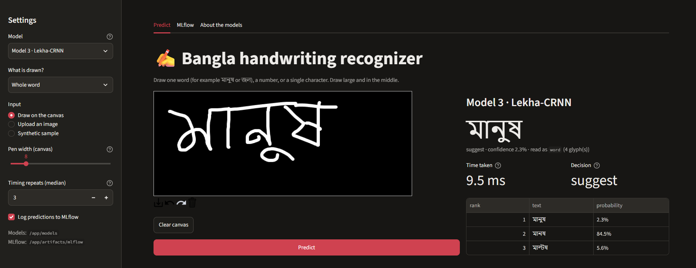
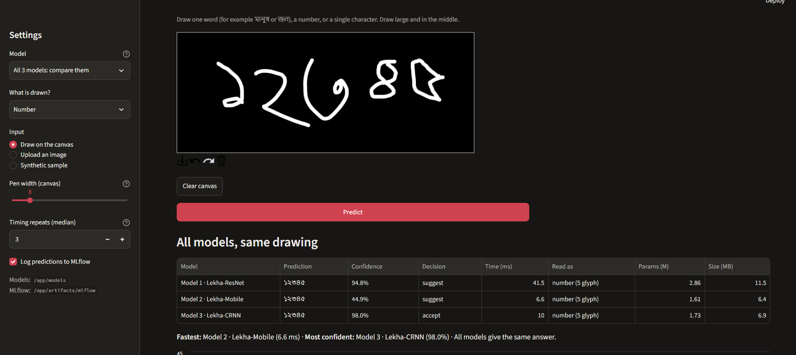
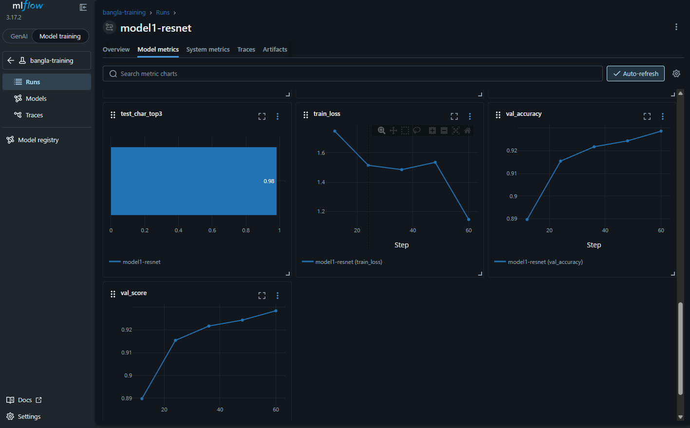
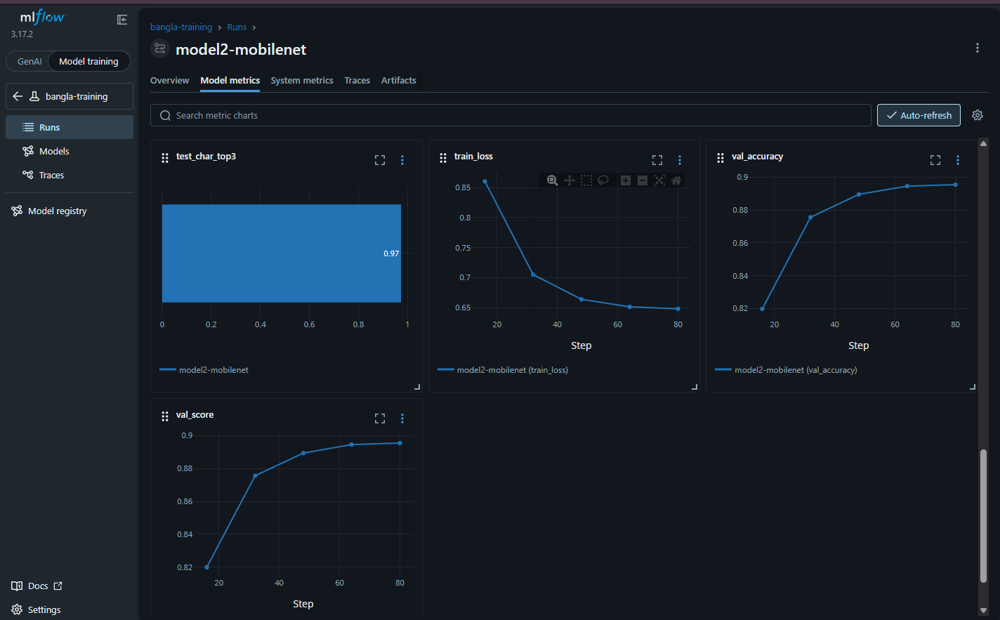
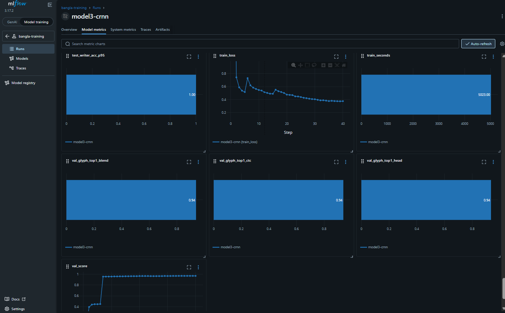

# Bangla Handwritten Word Recognition

**Name:** Mohammed Ali Hossain
**Student ID:** 1000128813
**Repository:** https://github.com/imohammedali101/bangla_ocr

Assignment 04, Skills for Industry Competitiveness and Innovation Program (SICIP), BRAC University.

Draw a Bangla word such as **মানুষ** or **জল** on a canvas, and the app predicts the **whole word**. The same app reads hand-drawn numbers and single characters, lets you choose
one of three models, shows how long each one takes, and can run all three on the same drawing and compare them. Training and testing results are tracked in MLflow,
and everything runs in one Docker image.

<div align="center">
  <h3>Try the app</h3>
  <p>Draw a Bangla word, character, or number—or compare all three models on the same input.</p>
  <table>
    <tr>
      <td align="center" width="50%">
        
        <br /><strong>Word recognition</strong><br />Model 3 predicts a complete handwritten Bangla word.
      </td>
      <td align="center" width="50%">
        
        <br /><strong>Model comparison</strong><br />Compare predictions, confidence, and inference time.
      </td>
    </tr>
  </table>
</div>

---

## Quick start (Docker)

```bash
git clone https://github.com/imohammedali101/bangla_ocr.git
cd bangla_ocr
docker build -t bangla-ocr-app:0.1 .
docker run -p 8501:8501 bangla-ocr-app:0.1
```

Open **http://localhost:8501**. The image contains the three models and the MLflow data, so nothing else has to be downloaded.

To also open the MLflow web page from Docker:

```bash
docker compose up -d        # app: http://localhost:8501   MLflow: http://localhost:5000
docker compose down         # stop (add -v to also reset the MLflow data volume)
```

---

## How it performed

All accuracy figures below are on **writers the models never saw in training** (the split is by writer, 80 / 10 / 10, over about 2,000 writers and 166,058 images).

### The three models side by side

| | Model 1 · ResNet | Model 2 · MobileNet | Model 3 · CRNN |
|---|---|---|---|
| Single glyph, top-1 | **93.37%** | 90.53% | 92.86% |
| Single glyph, top-3 | 98.22% | 97.37% | 98.00% |
| Calibration error (lower is better) | 0.78% | 0.98% | **0.67%** |
| Reads whole words and vowel signs | no | no | **yes** |
| Reads multi-digit numbers | by cutting into glyphs | by cutting into glyphs | **directly, 93.8% exact** |
| ONNX file size | 11.5 MB | **6.4 MB** | 6.9 MB |
| Time on a 5-digit drawing, Docker CPU | 41.5 ms | **6.6 ms** | 10.0 ms |

(The Docker times come from the screenshot above: median of 3 runs, including preprocessing and decoding. Models 1 and 2 first cut the drawing into glyphs, which is why Model 1 is slower on a multi-glyph drawing.)

**In short:** Model 1 is the most accurate on isolated characters, Model 2 is the smallest and fastest, and Model 3 is the only one that reads a whole word, vowel signs included, so it is the default in the app.
A plain CNN trained on the raw images reached only 50.25% top-1, but it used the same too-low learning rate as Models 1 and 2 (see Training), so treat it as a weak reference point, not as a measure of what the data engineering adds.

### Model 3 in detail (the word and number reader)

| Test | Result |
|---|---|
| Numbers of 1 to 8 digits, exact match | **93.8%** (1 to 4 digits: 96.2%; 5 to 8 digits: 89.0%); character error rate 2.14% |
| Words the model has never seen (random valid syllable strings), exact match | **79.1%** (words without vowel signs: 86.5%; with vowel signs: 77.0%) |
| Words from the built-in word list | 97.0%, but the model saw every one of these words during training, so this is **not** a held-out result |
| Isolated glyphs by group | numerals 97.0%, basic characters 93.3%, compound characters 90.1% |
| Isolated glyphs by handwriting quality | clear forms 97.3%, medium 94.3%, hard to read 83.7% |
| Per-writer accuracy | median 95.2%; the weakest 5% of writers are at 79.6% or below |
| Confidence quality | calibration error 0.67%. Answers accepted at 99% precision cover 74% of characters, 92% of numbers and 69% of words; the rest are shown as "suggest" with the top-3 |
| Speed on one CPU thread | 8.7 ms per image (the ONNX file, fp32) |

**Most common mistakes:** look-alike characters: ন্ধ read as ক্ষ (41 times), ন্দ as ল্প (23), ত as the digit ৩ (20), ম্ব as ও (19), আ as অ (15).

### Training

| Model | Epochs | End of training |
|---|---|---|
| Model 1 · ResNet | 60 | validation macro-F1 92.84% |
| Model 2 · MobileNet | 80 | validation macro-F1 89.55% |
| Model 3 · CRNN | 40 × 1,500 steps | validation score 0.97, about 84 minutes on a Kaggle GPU |

Models 1 and 2 were trained with a learning rate that turned out to be too low for this optimizer, so a longer or better-tuned run should improve them.
Model 3's validation score rises from 0.01 to 0.97 and jumps once the vowel signs enter its curriculum, around epoch 7. Every curve is in MLflow.

### What the two demo drawings show

* **A hand-drawn word, মানুষ (left screenshot).** Model 3 returned **মানুষ** in 9.5 ms. Be aware of how: the model alone gave 84.5% to the spelling মানষ (the vowel sign ু missing) and only 2.3% to মানুষ.
  The word list the app uses as a soft preference lifted মানুষ to first place, and the app marked the answer **"suggest"**, not "accept", with confidence 2.3%. The probability column shows the model's own probability for each spelling.
* **A hand-drawn five-digit number (right screenshot).** All three models gave the same answer. Model 3 was confident (98.0%, "accept"); Model 1 reached 94.8% and Model 2 44.9% (both "suggest").

These are two drawings, not a test set: how the system performs on real handwritten words in general has not been measured (see limitations).

---

## Approach

**The data problem.** BanglaLekha-Isolated has 84 classes of *isolated* glyphs (50 basic characters, 10 digits, 24 conjuncts). It has no word images and no vowel signs
(া ি ী ু ূ ৃ ে ৈ ো ৌ), yet the app must read whole words. The solution is to build words from the real glyphs and train a model that reads them.

**Dataset engineering** (all from the dataset's own ink; the split is always by writer):

| Step | What | Why |
|---|---|---|
| Cleaning | remove blanks, duplicates within a writer, and likely mislabels (confident learning) | label noise caps accuracy |
| Canonical glyphs | cropped, deslanted, centred 64×64 | learn shape, not pen or slant |
| Canvas style | strokes redrawn with a random brush | the app's input is a touch canvas, not a scan |
| Writer-style transfer | slant and pen width of another writer | more distinct "writers" |
| Counterfactual glyphs | the deciding dot removed or added (ড়↔ড, ঢ়↔ঢ, য়↔য, র↔ব) | the commonest confusions |
| Vowel signs | া cut from the same writer's আ; the others drawn as jittered strokes | the dataset has none |
| Reject samples | scribbles, fragments, blanks | the app can say "please redraw" |
| Word and number synthesis | glyphs of one writer placed on a joined headline (matra), labels in writing order (ি is written before its consonant) | whole-word reading |

**Models** (exported to ONNX, run with ONNX Runtime on one CPU thread):

* **Model 1 · Lekha-ResNet** and **Model 2 · Lekha-Mobile (MobileNetV3, distilled from Model 1):** classify one 64×64 glyph into 84 classes plus "not a character". Words and numbers are read by cutting the drawing into glyphs.
* **Model 3 · Lekha-CRNN (CNN + 2-layer BiGRU + CTC):** reads a whole drawing in one pass, including vowel signs. It is trained on words generated on the fly (a curriculum from simple words to vowel signs, overlaps and conjuncts)
  with an auxiliary per-glyph classifier. Words are decoded by CTC beam search with a *soft* word-list preference, so words outside the list can still be read.

**Reliability.** Every model is temperature-calibrated on validation writers. The app returns the prediction, its confidence, the top-3 alternatives and a decision: **accept** (confident), **suggest** (check the alternatives), or **reject** (redraw).

**The app** (Streamlit): a model dropdown (Model 1, 2, 3, or *All 3 models: compare them*), a drawing canvas (or image upload, or sample), the time taken per prediction, and, for the comparison, each model's answer, confidence,
time, size and whether the models agree. An **MLflow** tab shows the training runs and their artifacts, and every prediction made in the app is logged to MLflow.

---

## Run it locally

Python 3.10 or newer. One environment for everything:

```bash
python -m venv venv
source venv/bin/activate              # Windows PowerShell: .\venv\Scripts\Activate.ps1
pip install -r requirements.txt
```

| What | Command |
|---|---|
| Record the training runs in MLflow | `python train.py` |
| Open the MLflow page | `mlflow ui --backend-store-uri sqlite:///artifacts/mlflow/mlflow.db --host 0.0.0.0 --port 5000` |
| Run the app | `python -m streamlit run app.py` (http://localhost:8501) |
| Test the models on your own drawings | `python train.py predict my_drawings/` |

`python train.py predict` runs all three models on an image or a folder and prints each prediction with confidence, decision and time. In a folder, a file named `<what it says>_<number>.png`
(for example `জল_1.png`) is scored against its name, so a folder of your own drawings becomes a test set; the summary gives each model's accuracy and median time.

### MLflow

The experiment **`bangla-training`** holds one run per model (`model1-resnet`, `model2-mobilenet`, `model3-crnn`) and a baseline run (`baseline-cnn`). Each run has its parameters, the epoch curves, the test metrics,
the calibration, the exported model, a model card and the training log. Model 3 also stores its figures and its most common confusions. The experiment **`bangla-evaluation`** holds a side-by-side comparison of the models,
and **`bangla-serving`** collects the predictions made in the app.

### MLflow experiment tracking

The MLflow screenshots below show the experiment overview followed by the recorded run for each model. Each image uses a raw GitHub content URL so it can render directly in the README.

<div align="center">
  
  <br />
  <em>Experiment overview — training runs and tracked metrics.</em>
</div>

#### Model 1 · Lekha-ResNet

<div align="center">
  
  <br />
  <em>Model 1 — ResNet run details and metrics.</em>
</div>

#### Model 2 · Lekha-Mobile

<div align="center">
  
  <br />
  <em>Model 2 — MobileNetV3 run details and metrics.</em>
</div>

#### Model 3 · Lekha-CRNN

<div align="center">
  
  <br />
  <em>Model 3 — CRNN run details and metrics.</em>
</div>

---

## Training commands

The models in this repository were trained on Kaggle GPUs. To train them again from scratch (a GPU is strongly recommended; install the extra packages first):

```bash
pip install -r requirements-train.txt

python train.py train --data /path/to/BanglaLekha-Isolated                 # all three models
python train.py train --data /path/to/BanglaLekha-Isolated --profile quick # fewer epochs, much faster
python train.py train --data /path/to/BanglaLekha-Isolated --model crnn    # one model: resnet | mobilenet | crnn
python train.py test  --data /path/to/BanglaLekha-Isolated                 # test the saved models, logged to MLflow
```

`train` creates one MLflow run per model (parameters, per-epoch metrics, test metrics measured on the exported ONNX file, confusion matrix, model card) and writes the ONNX files and `models/config.json`.
`--profile smoke` is a two-minute check of the whole pipeline on a small sample, run in a scratch folder.

---

## Docker image as a file

To share the image without a registry:

```bash
docker save -o bangla-ocr-app-0.1.tar bangla-ocr-app:0.1      # on the machine that built it
docker load -i bangla-ocr-app-0.1.tar                         # on another machine
docker run -p 8501:8501 bangla-ocr-app:0.1
```

---

## Project structure

```
bangla_ocr/
|-- train.py                 python train.py (MLflow runs) | predict | train | test
|-- app.py                   Streamlit app
|-- bangla_common.py         labels, preprocessing, decoding, the three ONNX models, MLflow helpers
|-- notebook_extract.py      loads the training record into MLflow (used by python train.py)
|-- predict_cli.py           run the models on drawings from the command line
|-- requirements.txt         the one environment (also used by the Docker image)
|-- requirements-train.txt   extra packages, only for training from scratch
|-- Dockerfile  docker-compose.yml  .dockerignore  .gitignore
|-- labels.json              the 84 classes, the CTC tokens, the vowel signs
|-- models/                  the three ONNX models, config.json, lexicon.txt
|-- artifacts/mlflow/        mlflow.db (runs) and store/ (artifacts)
|-- notebooks/               the Kaggle training notebooks (the training record python train.py loads)
|-- screenshots/             the app and MLflow screenshots
|-- github_link.txt          the repository link
`-- make_submission.py       builds the source-only zip
```

The assignment's example structure lists `models/model.keras`; the models here are ONNX files in `models/`.

---

## Limitations

* **Vowel signs in training are synthetic.** The dataset contains none, so their appearance comes from a generator (one real stroke, the rest drawn). Real handwritten words, and their vowel signs in particular,
  have **not** been measured on a test set: the figures above for words are on words built from real glyphs, and the two demo drawings are not a test.
* **Single-glyph accuracy is the ceiling, about 93% on unseen writers** (top-3 about 98%). A word or number is only as accurate as its glyphs, and hard-to-read handwriting is much worse (83.7%). The figure is not directly comparable with
  published ones measured on random splits, where the same writer appears in training and test.
* **The word list shapes the answer.** The built-in list is small (189 words). A listed word can rank above a spelling the model finds more likely, as in the মানুষ demo, which is why such answers show "suggest" and the top-3 instead of "accept".
  Words outside the list can still be read, but less reliably.
* **Models 1 and 2 cannot read vowel signs** (they have no class for them) and cut words into glyphs with a simple rule, so words such as মানুষ are expected to go wrong with them. They are included for the comparison.
  They were also trained with a learning rate that was too low.
* **Parameter counts of Models 1 and 2 shown in the app are estimates** from the file size (about 4 bytes per weight); Model 3's count is exact.
* **Training from scratch with `train.py`** was verified only on a small sample of the data and on a CPU; the full-scale training was done on Kaggle. On Windows it runs without worker processes and is slow.
* Draw large, in the middle of the canvas, one word at a time; very small or very thin writing is read worse.
